# GridQ.ai Benchmark (Tesco demo) — quality reference for the frontend redesign

Reference capture for the redesign in [`docs/frontend_redesign_spec.md`](../../frontend_redesign_spec.md), benchmarking step. This is the quality bar our `src/gridq/app` frontend must match, screen by screen.

- **Captured:** 2026-06-25, via Playwright MCP (headless Chrome 149, channel `chrome`), as a guest (not signed in).
- **Reference site:** `https://gridq.ai` is Neura Energy's own polished deployment, branded **EASOS (Energy-as-a-Service OS)**. It already implements the exact target IA from our spec (left sidebar: Dashboard / Projects / Equipment, plus a 5-stage New Quote wizard). It is our own product, so capturing it is fine.
- **Demo path:** New Quote, **Load Demo Data** preloads the Tesco Express, Manchester site, then the full pipeline runs the real engine.
- **Viewports:** desktop 1440x900, mobile 390x844.
- **Auth-gated detail:** the **Proposal** and **Development** tabs (full financial proposal, PDF/Excel export) are behind Google sign-in and were not captured as a guest. The **3D sizing surface + heat-map is NOT a gridq.ai feature**: it is our own differentiator, to be built with judgement and refined via the capture/view/recurse loop, not benchmarked against the reference. See [Our differentiator](#our-differentiator-the-sizing-surface).

A note on copy: the reference uses em-dashes throughout its UI copy. Our spec forbids em-dashes in UI copy, so we match the reference on layout and polish but **not** on punctuation. Examples are called out per screen.

---

## Design system (ground truth, read from the live DOM)

Use these to author Tailwind directly. Values are computed styles, not guesses.

| Token | Value | Tailwind |
|---|---|---|
| Font family | `Inter, system-ui, sans-serif` (100% of elements) | `font-sans` with Inter loaded |
| Page background | `#F8FAFC` | `bg-slate-50` |
| Card / panel background | `#FFFFFF` | `bg-white` |
| Card border | `1px solid #F3F4F6` | `border border-gray-100` |
| Card radius | `12px` | `rounded-xl` |
| Card shadow | none (flat, hairline border only) | `shadow-none` |
| Card padding | `20px` | `p-5` |
| Primary accent (orange) | `#FF6B35` | custom `brand` color |
| Accent tint (active nav, selected) | `rgba(255,107,53,0.1)` | `bg-brand/10` |
| Button radius | `8px` | `rounded-lg` |
| Heading color (dark navy) | `#1A1A2E` | custom `ink` color |
| Body text | near-black | `text-gray-900` |
| Muted text scale | `#9CA3AF`, `#6B7280`, `#4B5563` | `text-gray-400/500/600` |
| Divider / input border | `#E5E7EB` | `border-gray-200` |
| Sidebar | white, fixed `240px`, right border `#E5E7EB` | `w-60 border-r border-gray-200` |
| Pills / step circles | `9999px` | `rounded-full` |

Suggested Tailwind theme extension:

```js
// tailwind.config — extend.colors
brand: { DEFAULT: '#FF6B35', tint: 'rgba(255,107,53,0.1)' },
ink: '#1A1A2E',
```

Design language in one line: **light, flat, hairline-bordered cards on a slate-50 canvas, Inter throughout, a single warm-orange accent (`#FF6B35`), 12px card radius, no drop shadows.** Restrained and engineering-serious, not flashy.

---

## Layout shell (every screen)

- **Left sidebar (240px, white):** EASOS logo + wordmark (links to neura.energy), nav (Dashboard / Projects / Equipment), a bordered **New Quote** button, then at the bottom a UK market switcher and a Guest / Sign in chip. Active nav item gets the orange tint background.
- **Main column:** a breadcrumb row (Dashboard / ...), then page content. Inside a project, a project context bar (flag, name, status pill, country / type / kVA) sits above a horizontal stage strip and a tab row (Overview / Pipeline / Proposal / Development).
- **Mobile:** sidebar collapses behind a hamburger ("Open menu"); main column goes single-column; stat grids reflow to 2-up; the wizard stepper reduces to bare numbered circles.

---

## Screen-by-screen flow

### 1. Front page / Dashboard
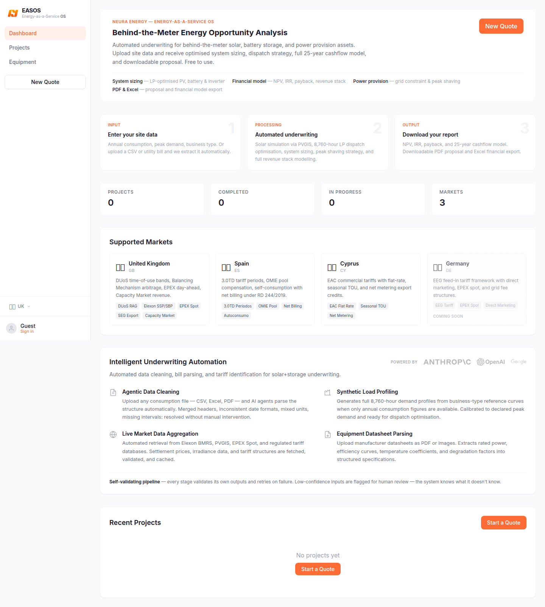

Visual-first dashboard. Hero ("Behind-the-Meter Energy Opportunity Analysis") with an orange New Quote CTA and four capability chips, then a 3-step **Input / Processing / Output** band, a row of 4 stat tiles (Projects / Completed / In Progress / Markets), **Supported Markets** cards (UK / Spain / Cyprus / Germany "Coming Soon"), an **Intelligent Underwriting Automation** feature grid ("Powered by" Anthropic / OpenAI / Google), and a Recent Projects table/empty-state.
Mobile: [`17-mobile-homepage.png`](17-mobile-homepage.png).
Copy note: hero and feature copy use em-dashes ("solar, battery storage — ...").

### 2. Wizard step 1 — Site Info (gating demo)
Empty / gated: 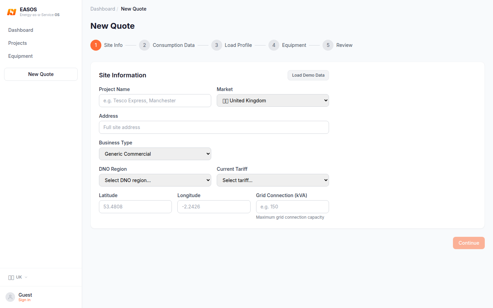 — Tesco-filled: 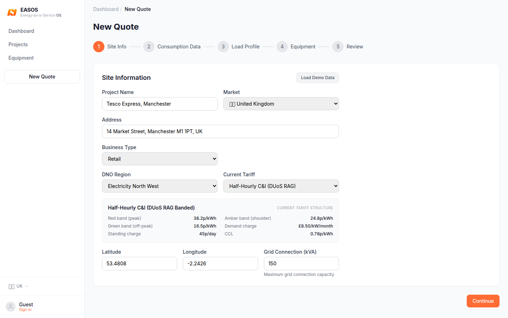

5-stage stepper (Site Info, Consumption Data, Load Profile, Equipment, Review). Fields: Project Name, Market, Address, Business Type, DNO Region, Current Tariff, Latitude, Longitude, Grid Connection (kVA). Selecting a tariff expands a **live tariff-structure card** (Red 38.2p / Amber 24.8p / Green 16.5p per kWh, demand charge £8.50/kW/month, standing 45p/day, CCL 0.78p/kWh).
**Gating:** Continue is disabled (faded orange) until inputs are valid, solid orange once valid. Gating is by disable only; there is **no explicit "what is still missing" list** (our spec asks for one, so we exceed here).
Mobile: [`18-mobile-wizard-step1-filled.png`](18-mobile-wizard-step1-filled.png).

### 3. Wizard step 2 — Consumption Data
Manual: 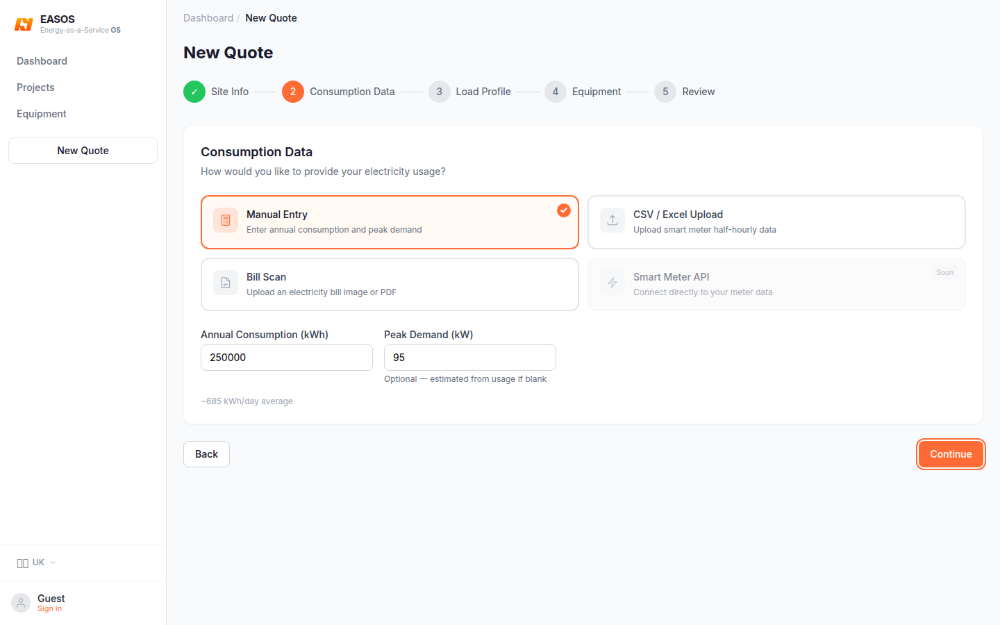 — CSV: 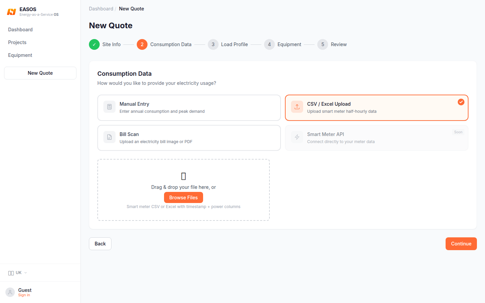 — Bill scan: 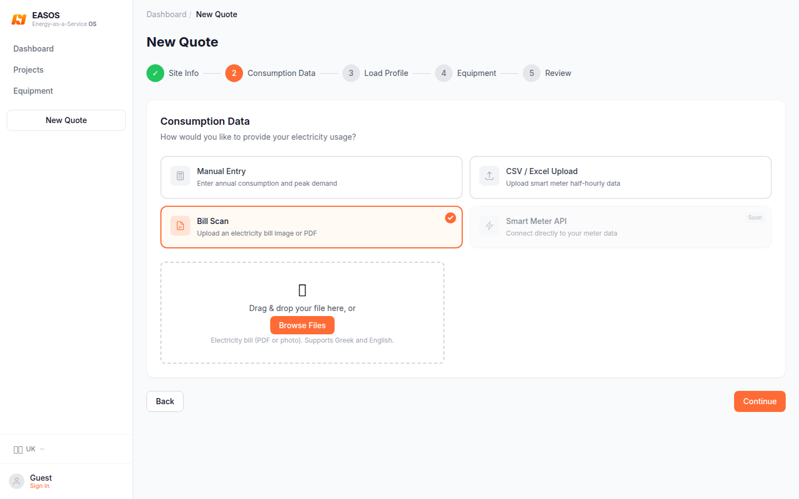

Four method tiles, exactly matching our spec: **Manual Entry**, **CSV / Excel Upload**, **Bill Scan** (PDF/image), **Smart Meter API** with a "Soon" badge (disabled). Manual entry shows Annual Consumption + Peak Demand and a live derived "~685 kWh/day average". CSV and Bill Scan swap in a drag-and-drop upload zone.
Copy note: "Optional — estimated from usage if blank" uses an em-dash.

### 4. Wizard step 3 — Load Profile (live curves)
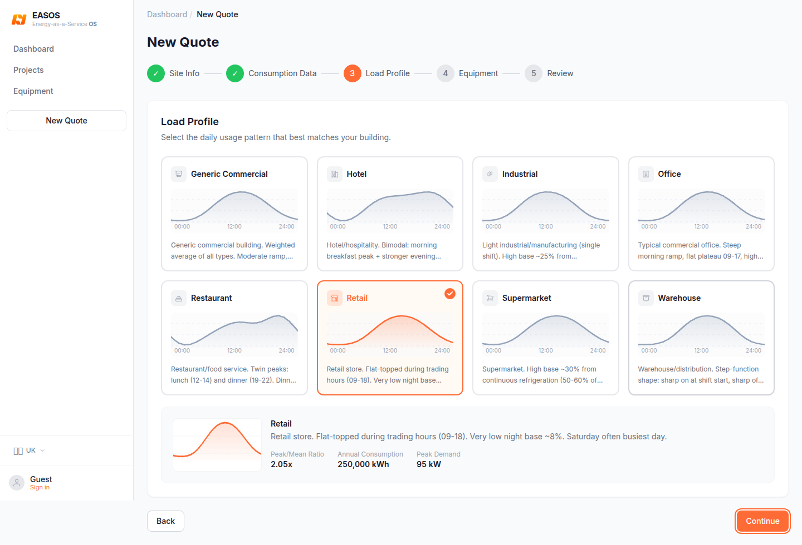

Eight business-type archetype cards (Generic Commercial, Hotel, Industrial, Office, Restaurant, Retail, Supermarket, Warehouse), each with a **mini curve sparkline** (00:00 / 12:00 / 24:00 axis) and a one-line description. The selected card (Retail) gets an orange border + check and drives a larger filled area-chart detail panel with derived stats: Peak/Mean Ratio 2.05x, Annual Consumption 250,000 kWh, Peak Demand 95 kW. This is the reference for our spec's "visualize the consumption data" / live-curve step.

### 5. Wizard step 4 — Equipment
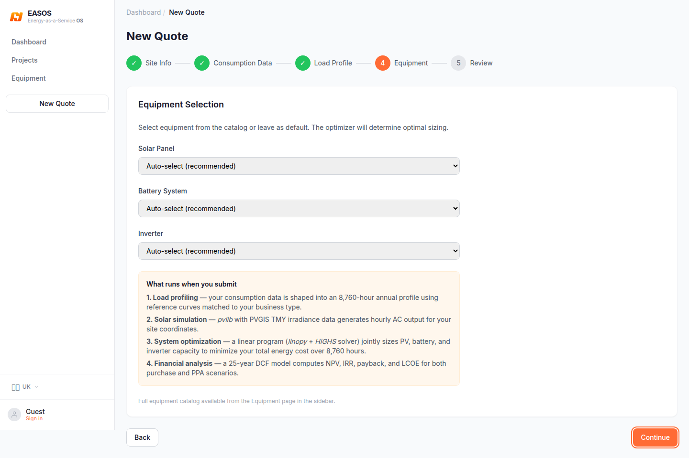

Three dropdowns, each defaulting to **Auto-select (recommended)** then a curated list of real products with correct per-type units: Solar (20 panels, `£/Wp`), Battery (5 LFP packs, `£/kWh`), Inverter (10 units, `£/W`). Below, a "What runs when you submit" explainer lists the 4 pipeline stages (load profiling, pvlib + PVGIS solar sim, linopy + HiGHS LP sizing, 25-year DCF). Full catalog lives on the Equipment page.
Copy note: explainer is em-dash heavy.

### 6. Wizard step 5 — Review
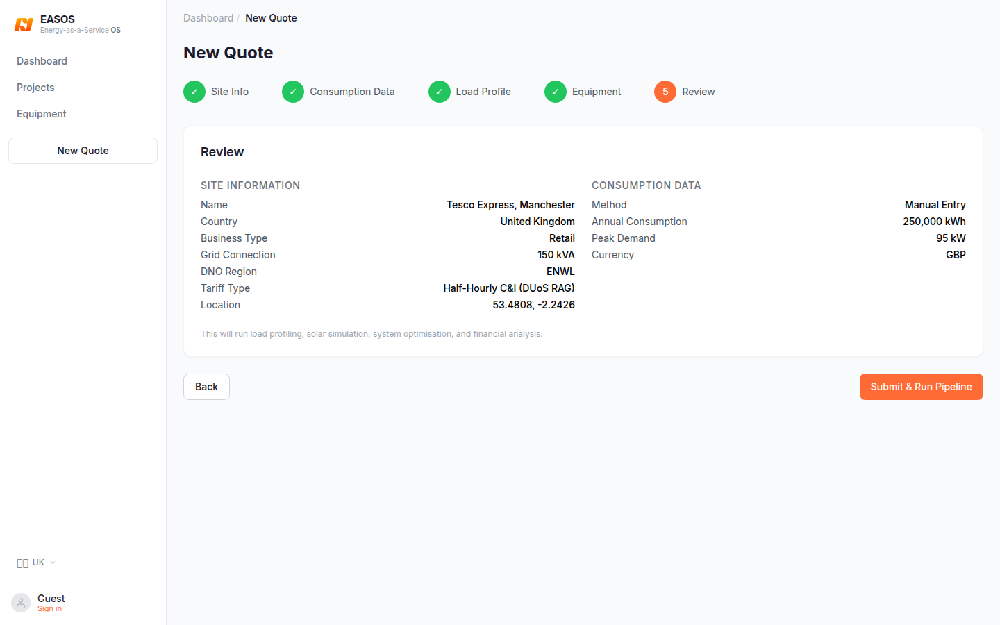

Two-column definition-list summary (Site Information + Consumption Data), all five steps ticked, final CTA **Submit & Run Pipeline**. This Review is text-only: no graphs or visuals of the chosen config. Our spec asks for "graphs and small visuals" here, so we exceed.

### 7. Run experience
Mid-run: 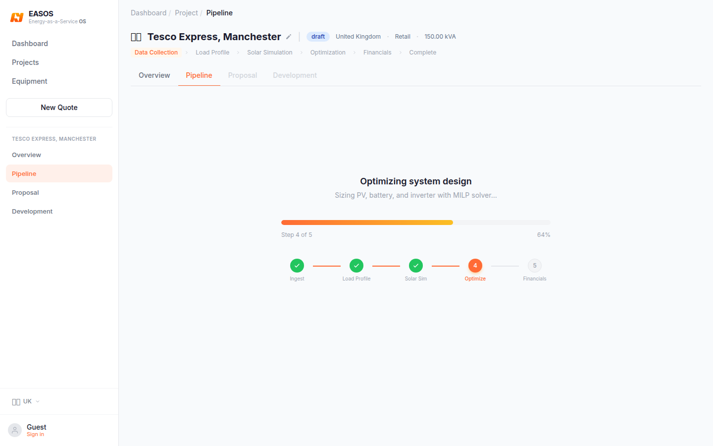 — Complete: 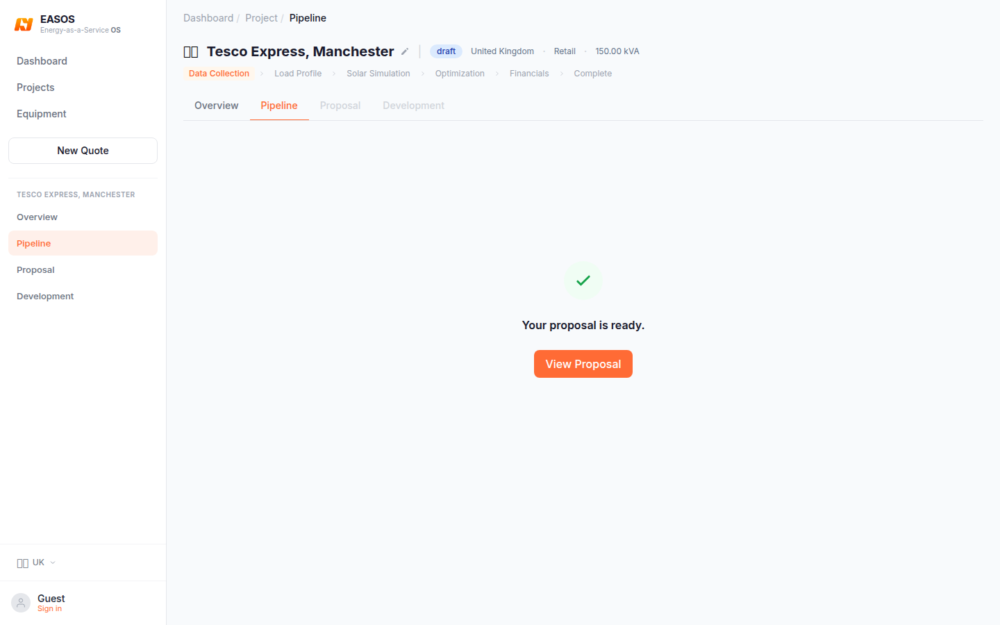

On submit, navigates to `/project/{id}/pipeline`. A horizontal stage strip (Data Collection, Load Profile, Solar Simulation, Optimization, Financials, Complete) sits at the top, and a centered progress card shows a live message ("Optimizing system design / Sizing PV, battery, and inverter with MILP solver..."), an orange gradient bar with **"Step N of 5" + percentage**, and a row of 5 step circles that tick green as each stage completes. On finish: "Your proposal is ready" with a View Proposal CTA.
**Transparency note:** the reference shows step **completion** but does **not** surface intermediate results inline as stages finish. Our spec explicitly wants results surfaced as each stage completes, so we exceed here.

### 8. Results — Overview (project dashboard)
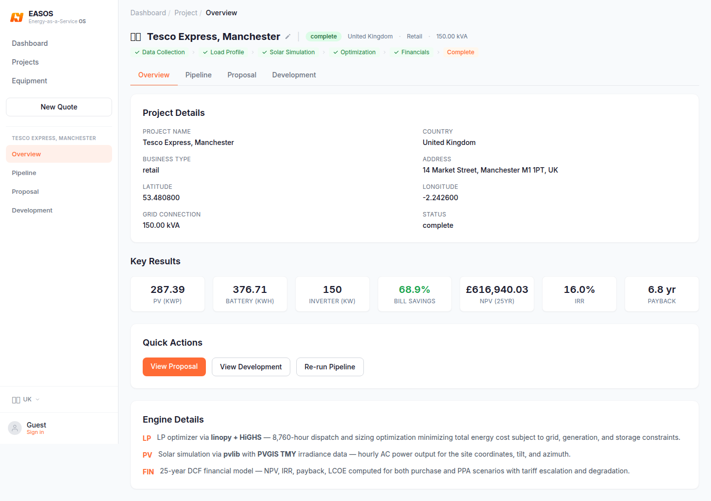

Ungated summary: Project Details, a **Key Results** stat-tile row (PV 287.39 kWp, Battery 376.71 kWh, Inverter 150 kW, Bill Savings 68.9% in green, NPV 25yr £616,940.03, IRR 16.0%, Payback 6.8 yr), Quick Actions (View Proposal / Development / Re-run), and Engine Details (LP / PV / FIN badges, em-dash copy).
Mobile: [`19-mobile-results-overview.png`](19-mobile-results-overview.png).

### Supporting pages
- **Equipment catalog** 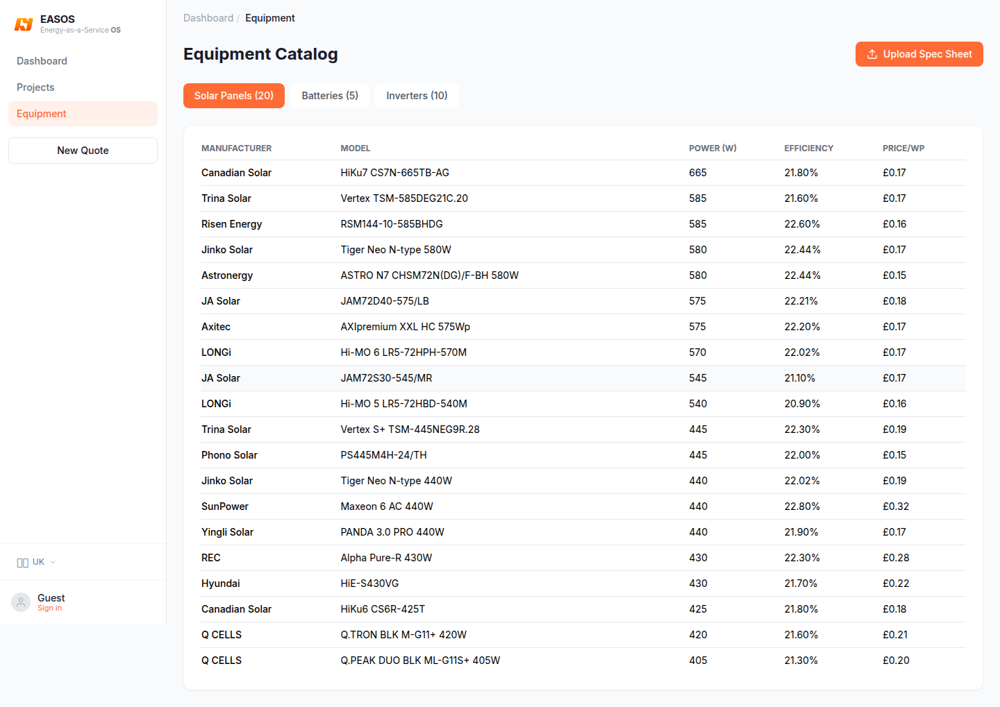: "Upload Spec Sheet" button (matches our spec), tabs Solar Panels (20) / Batteries (5) / Inverters (10), product table (Manufacturer / Model / Power / Efficiency / Price/Wp).
- **Projects** 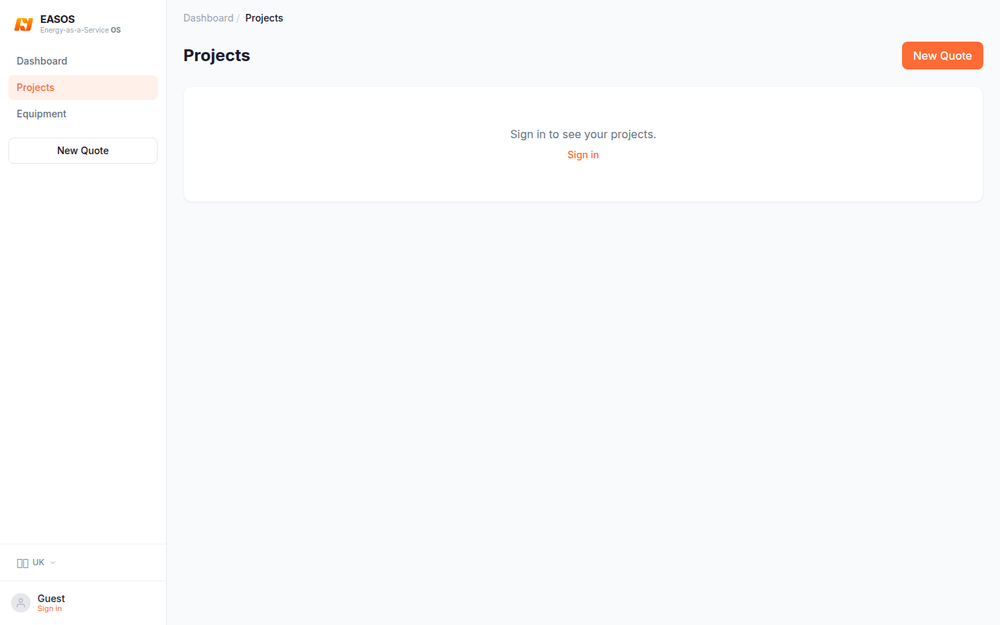: list of projects (the completed Tesco run appears with a View link).

---

## Our differentiator: the sizing surface
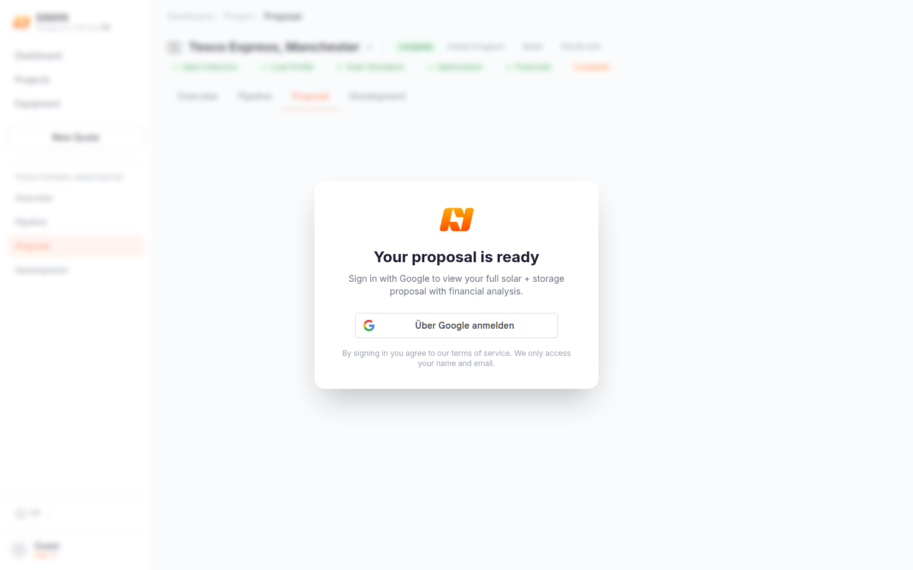

The **Proposal** and **Development** tabs render only a "Sign in with Google to view your full solar + storage proposal" gate as a guest, so the reference's financial proposal / export views were not captured. That is fine: those are not the redesign's centerpiece.

The **continuous 3D sizing surface shown side by side with its heat-map** is **not a gridq.ai feature**. It is our own edge. We do not benchmark it against the reference; we build it with judgement from our `SizingGrid` data (power x duration grid), then view it and recurse via the Playwright capture/compare/fix loop until it reads as a serious engineering surface and is intuitive. The reference sets the bar only for the surrounding shell (sidebar, cards, type, spacing, the orange accent); the surface itself we own.

---

## Per-screen quality target vs the rubric

The reference passes most of the 9 rubric items and defines the bar; the redesign must hit at least this on every screen. Items where the reference is **weak or silent**, so our build should exceed it rather than copy it:

| Rubric item | Reference standard | Where we must exceed |
|---|---|---|
| Clutter | One job per screen, strong hierarchy, restrained copy | Front page and some explainers are still fairly text-heavy; cut further |
| Comprehension | Clear, guided, self-explanatory | Match |
| Gating | Continue disabled until valid | Add an explicit "what is still missing" list (reference only disables) |
| Transparency | Step-by-step progress with live % and ticks | Surface intermediate **results** as each stage completes (reference does not) |
| Data feedback | Live tariff card, live load-profile curves, derived daily average | Add live modelled curves **while typing** in earlier steps too |
| Surface quality | Not a reference feature (our edge) | Build continuous surface + side-by-side heat map with judgement; refine via the recurse loop |
| Polish | Inter, flat hairline cards, `#FF6B35` accent, consistent spacing | Match exactly (tokens above) |
| Responsiveness | Sidebar to hamburger, grids reflow 2-up, clean at 390px | Match |
| Copy hygiene | Uses em-dashes throughout | **Do not copy:** no em-dashes anywhere in our UI copy |

Other spec features the reference does not show, so build to spec rather than to reference: address **type-ahead autocomplete**, **map drop-a-pin**, and a **visual Review** with graphs.

---

## Screenshot index

| # | File | Screen |
|---|---|---|
| 01 | `01-homepage-desktop-full.png` | Front page / Dashboard (desktop) |
| 02 | `02-wizard-step1-site-empty-gated.png` | Step 1 Site Info, empty (Continue gated) |
| 03 | `03-wizard-step1-site-filled-tesco.png` | Step 1 Site Info, Tesco demo filled |
| 04 | `04-wizard-step2-consumption-manual.png` | Step 2 Consumption, Manual Entry |
| 05 | `05-wizard-step2-consumption-csv-upload.png` | Step 2 Consumption, CSV/Excel upload |
| 06 | `06-wizard-step2-consumption-bill-scan.png` | Step 2 Consumption, Bill Scan |
| 07 | `07-wizard-step3-load-profile.png` | Step 3 Load Profile (live curves) |
| 08 | `08-wizard-step4-equipment.png` | Step 4 Equipment selection |
| 09 | `09-wizard-step5-review.png` | Step 5 Review |
| 10 | `10-run-pipeline-progress-A.png` | Run, mid-pipeline (Step 4 of 5, 64%) |
| 11 | `11-run-pipeline-progress-B.png` | Run, progress (viewport) |
| 12 | `12-run-pipeline-complete.png` | Run complete ("proposal ready") |
| 13 | `13-results-overview.png` | Results, Overview / Key Results |
| 14 | `14-proposal-signin-gate.png` | Proposal/Development auth gate |
| 15 | `15-equipment-page.png` | Equipment catalog + Upload Spec Sheet |
| 16 | `16-projects-page.png` | Projects list |
| 17 | `17-mobile-homepage.png` | Front page (mobile 390px) |
| 18 | `18-mobile-wizard-step1-filled.png` | Step 1 (mobile 390px) |
| 19 | `19-mobile-results-overview.png` | Results overview (mobile 390px) |
